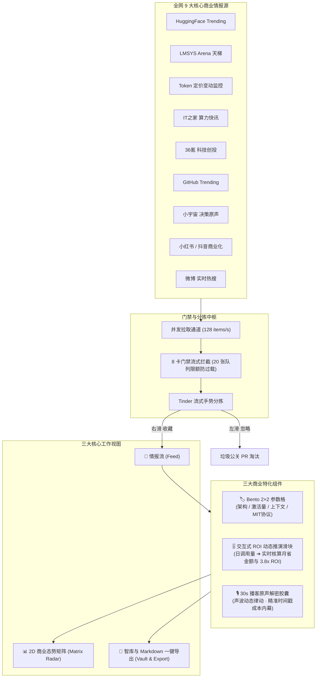
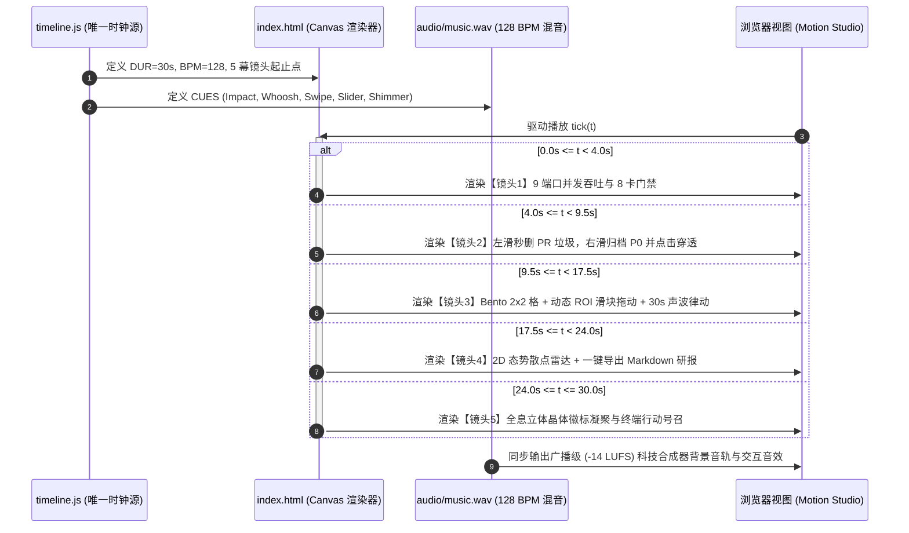

# InsightX 2.0 仓库全景指向文件与代码索引 (Repository & Code Index)

> **面向对象**：Codex / AI Agent / 系统架构师 / 协同开发者。  
> **文档功用**：提供工程仓库拓扑结构、核心文件职责清单、数据流转调用链路图以及关键文件物理路径指向，确保对整套代码库实现 100% 结构化掌控。

---

## 一、 仓库目录拓扑总览

```text
InsightX项目资料/
├── README.md                      # 项目主说明文档（产品定位、特化功能与快速开始）
├── HANDOVER.md                    # 详尽的历次交互迭代与全链路交接记录
├── REPO_INDEX.md                  # 【本文档】代码仓库全景指向与架构索引
├── LICENSE                        # MIT 开源协议文本
├── .gitignore                     # 规范的依赖与临时文件忽略规则
│
├── frontend/                      # 前端客户端（纯前端单页架构）
│   └── index.html                 # Obsidian 极暗美学单页客户端（含手势卡片、Bento 格、ROI 滑块与声波组件）
│
├── backend/                       # Python FastAPI 后端服务
│   ├── requirements.txt           # 后端 Python 依赖声明清单
│   ├── .env.example               # 后端环境变量模板
│   └── app/
│       ├── main.py                # FastAPI 应用程序主入口
│       ├── config.py              # 配置管理与环境变量读取
│       ├── models/                # Pydantic 商业情报数据实体模型
│       │   └── intelligence.py    # 结构化情报卡片、Bento 格与财务 ROI 数据定义
│       └── services/              # 业务服务层
│           ├── scraper.py         # 多端口数据采集服务
│           ├── whisper_audio.py   # 播客长音频转录与切片服务
│           └── llm_extractor.py   # LLM 结构化商业四象限提炼服务
│
├── docs/                          # 产品与系统架构设计文档
│   ├── PRD_v2.0.md                # 完整的 2.0 需求规格说明书
│   ├── ARCHITECTURE.md            # 系统技术架构设计与数据流图
│   └── PRD_v1.0_legacy.md         # 历史 v1.0 版本归档
│
├── insightx-showreel/             # 30 秒 16:9 全息宣传片动效工程
│   ├── index.html                 # 30 秒全片总装渲染器（整合 5 幕镜头）
│   ├── timeline.js                # 共享节拍时钟中枢（128 BPM、分镜时刻与音效 Cues）
│   ├── motion.js                  # 60FPS Canvas 运动学物理引擎（Spring、Lerp、Seg、Easing）
│   ├── score.mjs                  # AI 科技律动合成音轨（128 BPM，-14.0 LUFS 广播级规范）
│   ├── preview.js                 # 交互式时间轴拖拽与播放驱动控制器
│   ├── brief.md                   # 宣传片创意简报、分镜脚本与设计规范
│   ├── package.json               # 动效工程配置清单
│   ├── audio/
│   │   └── music.wav              # 自动合成渲染的 30.00 秒无损音轨
│   ├── shots/                     # 独立镜头沙盒目录（各具备独立 index.html 与验证机制）
│   │   ├── s01/                   # 镜头 1 (0.0s - 4.0s)：9 大核心端口并发拉取与 8 卡流式门禁
│   │   ├── s02/                   # 镜头 2 (4.0s - 9.5s)：Tinder 手势分拣（左滑忽略/右滑收藏）与点击穿透
│   │   ├── s03/                   # 镜头 3 (9.5s - 17.5s)：三大特化组件（Bento 格 + ROI 滑块 + 30s 播客原声波形）
│   │   ├── s04/                   # 镜头 4 (17.5s - 24.0s)：多维视图切换（2D 态势矩阵 + 智库一键导出研报）
│   │   └── s05/                   # 镜头 5 (24.0s - 30.0s)：InsightX 2.0 全息晶体徽标凝聚落版与行动号召
│   └── .showreel-progress/        # 进度追踪与版本快照存档目录
│
└── archive/                       # 早期历史草稿与迭代存档
```

---

## 二、 核心文件职责矩阵与代码指向

| 文件路径 | 语言/格式 | 核心职能与设计职责 | 关键出口 / API / 变量 |
| :--- | :--- | :--- | :--- |
| `frontend/index.html` | HTML5 / JS / Tailwind | 客户端核心单页；实现卡片流拖拽手势、Bento 2x2 网格、无极 ROI 推演滑块、声波播放器、2D 态势矩阵及智库 Markdown 研报导出 | `localStorage` 本地自治，无外网密钥泄露风险 |
| `backend/app/main.py` | Python (FastAPI) | 后端服务入口；挂载路由、CORS 中间件与全局异常捕获 | Swagger 路径 `/docs` |
| `insightx-showreel/index.html` | HTML5 / Canvas | 30 秒全片总装主引擎；基于统一时间轴 `window.render(t)` 顺序驱动 5 幕场景，支持毫秒级精准切片 | `window.DUR = 30.0;`<br>`window.render = t => ...` |
| `insightx-showreel/timeline.js` | JavaScript (ESM) | 视听同频时钟事实中枢；定义全片标准时长、128 BPM 音乐时钟、5 幕分镜边界与音效触发字典 | `DUR`, `BPM`, `BEAT`, `SHOTS`, `DROPS`, `CUES` |
| `insightx-showreel/motion.js` | JavaScript (ESM) | 运动学数学方程库；提供弹性阻尼震荡、非线性插值、视口自适应适配与画布 DPR 缩放 | `spring`, `springTo`, `ease`, `lerp`, `seg`, `stageSize`, `setupCanvas` |
| `insightx-showreel/score.mjs` | JavaScript (ESM) | AI 纯代码式音乐与音效合成器；生成驱动感四四拍电子科技节拍、16 分音符琶音、动态闪避（Sidechain Ducking）及同步音效 | `export default function score(S)` |
| `insightx-showreel/brief.md` | Markdown | 宣传片顶层创意简报；包含方向 B (全息空间雷达) 视觉规范、配色代码表与分镜台本 | 视觉设计基准指南 |

---

## 三、 系统架构与数据链路图



---

## 四、 动效渲染引擎（Showreel）架构与视听同频机制



---

## 五、 全局扩展技能（Installed Skills）位置指引

当前环境已在宿主中部署了整套专业级能力库，均位于：
`C:\Users\黄斌\.gemini\config\skills\`

1. **`motion-showreel`** (`C:\Users\黄斌\.gemini\config\skills\motion-showreel`):
   - 本项目宣传片的驱动核心；已对 `scripts/lib/narration.mjs` 完成**纯原生 Node.js WAV RIFF 头部解析增强**，在 Windows 无 ffprobe 环境下原生支持时长提取与最终发布。
2. **`web-design-engineer`** (`C:\Users\黄斌\.gemini\config\skills\web-design-engineer`):
   - 前端视觉设计与工程验收专家。
3. **`web-video-presentation`** (`C:\Users\黄斌\.gemini\config\skills\web-video-presentation`):
   - 点击驱动式 16:9 交互网页演示生成系统。
4. **`beautiful-article`** (`C:\Users\黄斌\.gemini\config\skills\beautiful-article`):
   - 单文件离线长文排版设计工具。
5. **`gpt-image-2`** (`C:\Users\黄斌\.gemini\config\skills\gpt-image-2`):
   - 结构化高质感图像提示词工程库。
6. **`kb-retriever`** (`C:\Users\黄斌\.gemini\config\skills\kb-retriever`):
   - 分层知识库渐进检索助手。

---

## 六、 常用命令与排障手册 (Cheat Sheet)

### 1. 动效确定性回归测试 (100% Determinism Test)
```powershell
node "C:\Users\黄斌\.gemini\config\skills\motion-showreel\scripts\render.mjs" "c:\Users\黄斌\Desktop\InsightX项目资料\insightx-showreel" --determinism
```
> **通过指标**：输出 `deterministic: 6 frames match across render orders`。若报错，请重点检查是否遗漏了 `ctx.restore()` 或在 `render(t)` 内调用了随机数。

### 2. 重新编译 AI 合成音轨 (Build Sound Score)
```powershell
node "C:\Users\黄斌\.gemini\config\skills\motion-showreel\scripts\audio.mjs" build "c:\Users\黄斌\Desktop\InsightX项目资料\insightx-showreel\score.mjs"
```
> **通过指标**：输出 `30.00s, -14.0 LUFS, sample peak -1.5 dBFS`。

### 3. 打开 30 秒全片总装可视化工作区 (Motion Studio)
```powershell
node "C:\Users\黄斌\.gemini\config\skills\motion-showreel\scripts\editor.mjs" "c:\Users\黄斌\Desktop\InsightX项目资料\insightx-showreel" --size 1920x1080 --fps 30 --duration 30 --audio "audio/music.wav"
```
> 当前后台服务持续驻留中，可在浏览器访问：[`http://127.0.0.1:62932/editor`](http://127.0.0.1:62932/editor)
